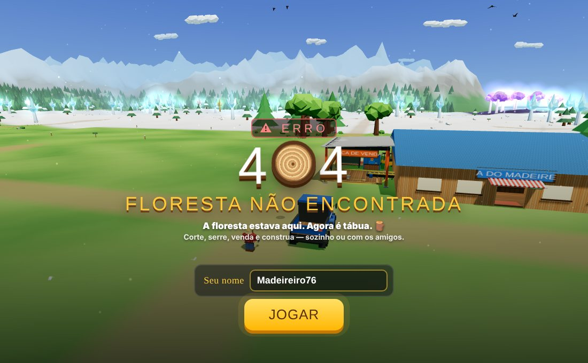
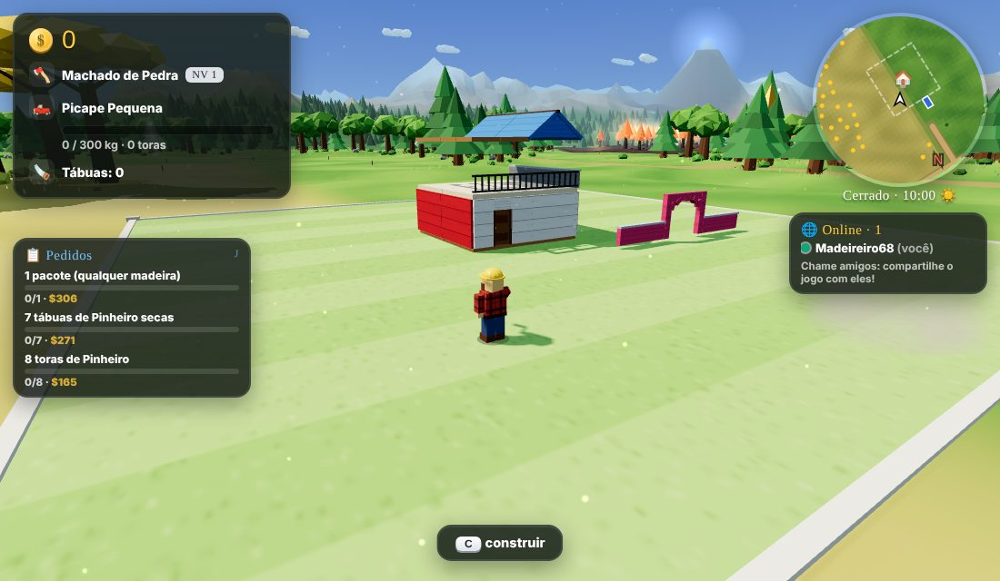
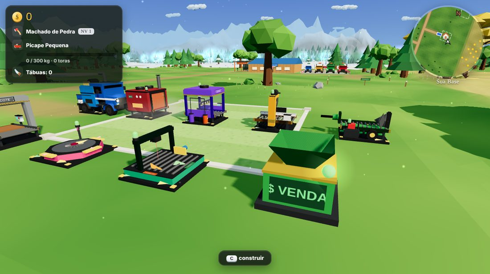
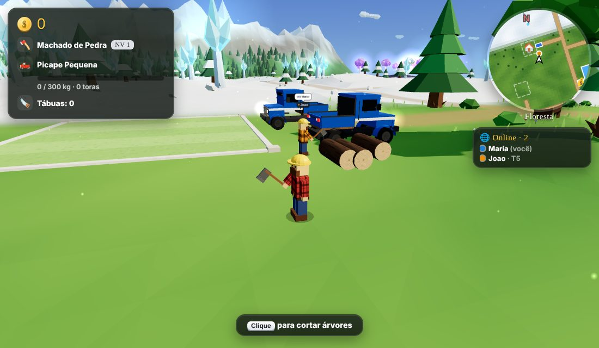
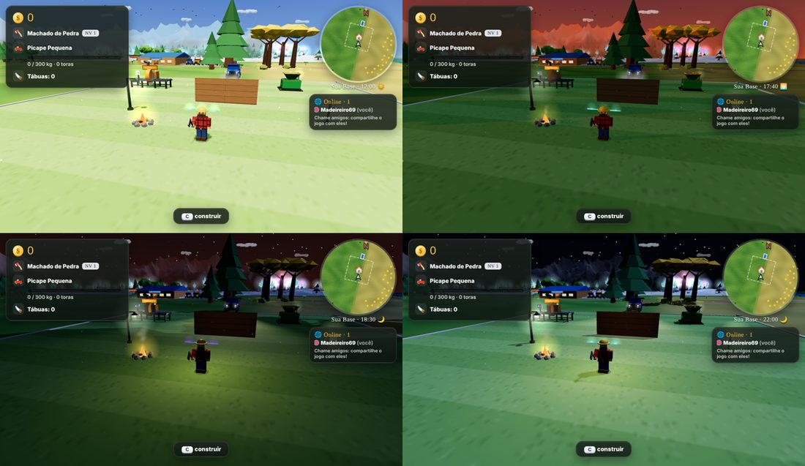
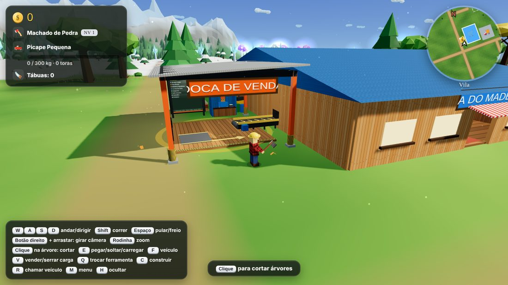
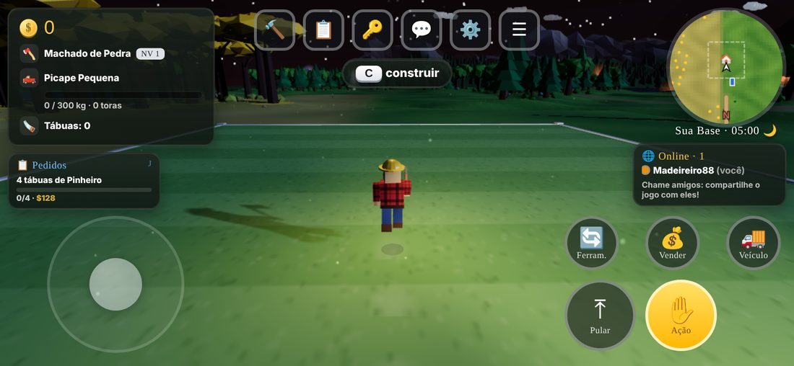

<div align="center">

# ⚠️ ERRO 404: FLORESTA NÃO ENCONTRADA

**A floresta estava aqui. Agora é tábua. 🪵**
Corte, carregue, serre, venda e construa — sozinho ou com os amigos.
Um jogo de madeira em 3D que roda direto no navegador, inspirado em *Lumber Tycoon 2*.

[**▶ Jogar agora**](https://brjhon.github.io/floresta-404/) · [Como jogar](#-como-jogar) · [Jogar com amigos](#-jogar-com-amigos) · [Novidades](CHANGELOG.md)



</div>

---

## 🌲 Sobre o jogo

Você começa com um machado de pedra, uma picape e um terreno vazio. Derruba árvores, leva as toras pra serraria, vende tábuas, compra máquinas melhores e transforma o terreno numa fábrica de madeira — com casa, luzes, esteiras e tudo que a sua criatividade mandar.

O mapa é enorme: floresta, **Cerrado**, **Neve**, **Vulcão**, **Clareira Lunar** e uma **Ilha Tropical** do outro lado da ponte, cada um com madeiras próprias. Vez ou outra aparece uma **árvore anormal** (Dourada, Fantasma, Arco-íris...) que vale muito mais.

## 📸 Imagens

| | |
|---|---|
|  |  |
| **Construção livre** — paredes, telhados, portas que abrem, tinta, 2º andar | **Máquinas encadeáveis** — plaina, estufa, verniz, empacotadora e mais |
|  |  |
| **Multiplayer** — veja os amigos, as bases e os caminhões deles | **Dia e noite** — pôr do sol, estrelas, faróis e lanterna |
|  |  |
| **Doca de venda** — esteira, balança e painel de preços | **Celular** — joystick e botões na tela |

## 🎮 Como jogar

| Ação | Computador | Celular |
|---|---|---|
| Andar / dirigir | `W` `A` `S` `D` (`Shift` corre) | Joystick à esquerda |
| Girar câmera / zoom | Botão direito + arrastar / rodinha | Arrastar o dedo / pinça |
| Cortar árvore | Clique na árvore | Toque (segure pra continuar) |
| Pegar, soltar, colocar | `E` | ✋ Ação |
| Entrar no veículo | `F` | 🚚 |
| Vender / serrar a carga | `V` | 💰 |
| Trocar ferramenta | `Q` | 🔄 |
| Construir | `C` | 🔨 |
| Ver máquina / tamanho das tábuas | `T` ou clique na máquina | ⚙️ ou toque |
| Pedidos e conquistas | `J` | 📋 |
| Permissões da base | `P` | 🔑 |
| Chat | `Enter` | 💬 |
| Menu | `M` | ☰ |

**No modo construção:** `R` girar · `X` remover · `T` madeira · `Y` tinta · `B` pintar peça · `G` copiar peça · `Q`/`Z` trocar de andar · `U` expandir terreno.

## ✨ O que tem no jogo

- **6 ferramentas** (do Machado de Pedra à Serra Lunar) e **4 veículos** (da Picape à Carreta Bitrem).
- **Loja de verdade:** você entra, pega o item na prateleira, leva até o caixa e paga.
- **Serrarias com tamanho de tábua ajustável** — comprimento, largura e espessura (até vigas).
- **Máquinas que se ligam por esteiras:** Plaina (+30%), Estufa (+25%), Envernizadora (+40%), Destopadeira, Rachador de Lenha, Empacotadora (+15%), Divisor e Separador.
- **Estação de venda** na sua base: a produção já sai vendida.
- **Construção:** 20+ peças, 11 cores de tinta, portas automáticas, telhados, grades, arcos e vários andares.
- **Física das toras:** rolam no morro, empilham em pirâmide, boiam na água e caem do caminhão em curva fechada.
- **Pedidos do comprador** com bônus e **20 conquistas** com prêmio.
- **Ciclo de dia e noite** sincronizado entre todos os jogadores.
- **Mundo salvo:** sua base volta exatamente como você deixou — itens, máquinas e caminhão.
- **Multiplayer:** bases dos outros, roubo de madeira fora das bases 🦝 e permissões de visita.

## 🌐 Jogar com amigos

1. Na tela inicial, digite seu nome e clique em **Criar sala**.
2. Clique em **🔗 Copiar link da sala** e mande pros amigos (WhatsApp, Discord...).
3. Quem abrir o link entra direto na sua sala. Também dá pra digitar o código e clicar em **Entrar**.

A conexão é direta entre os jogadores (P2P). Se quem criou a sala sair, outro jogador assume e a partida continua. Funciona melhor com até 6–8 pessoas por sala. O progresso de cada um fica salvo no próprio navegador.

## 🛠 Para desenvolver

```
floresta-404/
├── index.html          ← o jogo pronto (é o que vai pro site)
├── src/jogo.html       ← código-fonte do jogo
├── tools/p2p.js        ← salas multiplayer com código
├── tools/build.py      ← gera o index.html a partir do src/
├── docs/img/           ← imagens do README
└── .github/workflows/  ← publica no GitHub Pages
```

```bash
npm install        # baixa three.js e PeerJS
npm run build      # gera o index.html
npm run dev        # abre em http://localhost:8080
```

Edite sempre o `src/jogo.html` e rode `npm run build` antes de enviar.

## 🚀 Publicar

**GitHub Pages (automático):** em *Settings → Pages*, escolha *Source: GitHub Actions*. A cada envio pra `main`, o jogo é publicado em `https://brjhon.github.io/floresta-404/`. *(No plano grátis do GitHub, o Pages exige repositório público.)*

**Netlify Drop:** arraste o `index.html` (dentro de uma pasta ou .zip) em [app.netlify.com/drop](https://app.netlify.com/drop) e crie uma conta grátis pra manter o site no ar.

## 🗺 Próximos passos

- [ ] Servidor próprio com login e progresso salvo na nuvem
- [ ] Copiar e colar áreas inteiras da base
- [ ] Mais biomas e madeiras raras
- [ ] Sons e música de fundo
- [ ] Missões com história

## 🙌 Créditos

Criado por **Jhon** ([@brjhon](https://github.com/brjhon)), desenvolvido com a ajuda do Claude.

Usa [three.js](https://threejs.org) (MIT) para os gráficos 3D e [PeerJS](https://peerjs.com) (MIT) para o multiplayer.
